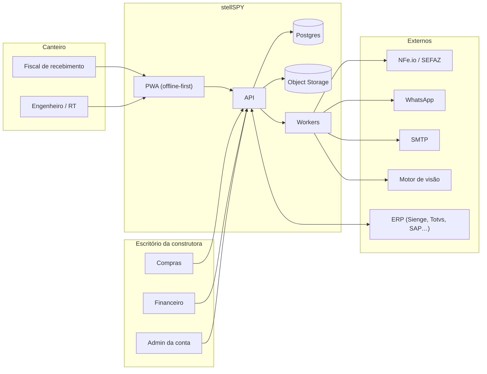
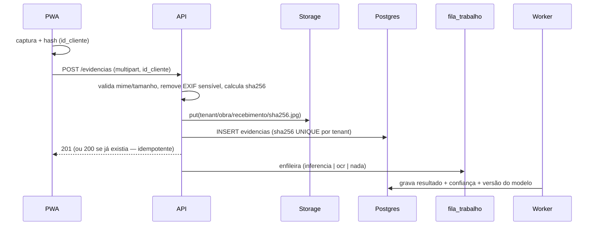
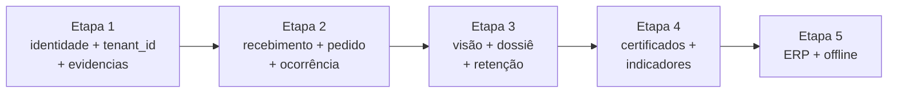

# stellSPY 2.0 — Arquitetura-Alvo

> Desenho de destino. **Nada implementado.** A estratégia é evolutiva: a fundação cresce em volta do
> núcleo existente, que permanece intacto.

## 1. Princípios que governam o desenho

| # | Princípio | Tradução prática |
|---|-----------|------------------|
| P1 | **Núcleo intacto** | `domain/conferente.py` não é reescrito; recebe entradas mais ricas |
| P2 | **Monólito modular** | Sem microserviços antes de 50 clientes pagantes |
| P3 | **Fundação antes de feature** | Identidade e evidência antes de visão computacional |
| P4 | **Tudo auditável** | Toda decisão gera linha imutável com autor, origem e versão |
| P5 | **Assíncrono no que é lento** | Inferência, PDF, WhatsApp e ERP vão para fila |
| P6 | **Degradação graciosa** | Falha de IA, WhatsApp ou ERP nunca bloqueia o recebimento |
| P7 | **Offline é copy-on-write no cliente** | O dispositivo é dono do rascunho; o servidor é dono da verdade |

## 2. Contexto (C4 nível 1)



## 3. Módulos (bounded contexts)

Cada módulo é um pacote com router, domínio e serviços próprios. Comunicação **entre módulos só por
serviço explícito**, nunca importando tabela alheia.

| Módulo | Responsabilidade | Fase |
|--------|------------------|------|
| `identidade` | Construtora, usuário, papel, sessão, API keys | 1 |
| `obras` | Obra, especificação, equipe da obra | 1 |
| `evidencias` | Upload, storage, hash, EXIF, retenção | 1 |
| `recebimentos` | O evento de recebimento (data, portaria, veículo, conferente) | 1 |
| `nfe` | Importação, parsing, normalização | existente |
| `pedidos` | Pedido de compra, itens, fornecedor, preço | 2 |
| `conferencia` | Motor de matching e status | existente |
| `divergencias` | Ocorrência, ciclo de vida, responsável, prazo | 2 |
| `retencao` | Solicitação de retenção, aprovação, histórico | 3 |
| `dossie` | Consolidação documental e exportação | 3 |
| `visao` | Inferência, revisão humana, métricas | 3 |
| `certificados` | Laudos, certificados, validade, norma | 4 |
| `fornecedores` | Indicadores por CNPJ emitente | 4 |
| `erp` | Adaptadores de integração | 5 |
| `sincronizacao` | Fila offline, resolução de conflito | 5 |
| `plataforma` | Auditoria, outbox, feature flags, métricas | 1 |

> **Nota de escopo:** `conferencia` e `nfe` **não** mudam de pasta neste plano. São renomeados como
> módulos conceituais; a reorganização física acontece só quando houver ganho comprovado.

## 4. Multiempresa (decisão estruturante)

### 4.1 Estratégia escolhida: schema único + `tenant_id`

| Alternativa | Veredito |
|-------------|----------|
| **Banco por cliente** | Isolamento máximo, operação O(n) — inviável com 1 pessoa |
| **Schema por cliente** | Meio-termo, mas migração multi-schema é dor desnecessária |
| **Schema único + `tenant_id` + RLS** ✅ | Padrão da indústria para este porte; RLS dá defesa em profundidade |

### 4.2 Regras não negociáveis

1. `tenant_id` em **toda** tabela de agregado, `NOT NULL`, indexado, parte das chaves únicas.
2. `construtoras` é o tenant. `obras` pertence a uma construtora.
3. **A API não conecta como superusuário.** Este é o ponto que a auditoria expôs: hoje a conexão é
   `postgres`, que tem `BYPASSRLS` — qualquer RLS seria decorativa. É preciso uma role de aplicação
   (`stellspy_app`) sem `BYPASSRLS`, com `SET LOCAL app.tenant_id` por transação.
4. RLS é **defesa em profundidade**, não a única barreira: o filtro na query continua obrigatório.

```sql
-- Ilustrativo (NÃO executar)
ALTER TABLE obras ENABLE ROW LEVEL SECURITY;
CREATE POLICY obras_tenant ON obras
  USING (tenant_id = current_setting('app.tenant_id', true)::uuid);
```

### 4.3 Identidade

| Ator | Credencial | Escopo |
|------|-----------|--------|
| Usuário humano | Cookie de sessão assinado (evolução do `pwa_session.py`) com `sub`, `tenant`, `role` | Por usuário |
| Integração (ERP, script) | API key com escopo e `tenant_id` | Por obra ou por tenant |
| Dispositivo offline | Token de dispositivo de curta duração + `id_cliente` | Por obra |

O padrão de cookie HMAC já existente em `pwa_session.py` é reaproveitável: adicionar claims (`sub`,
`tenant`, `role`) mantém a propriedade boa — sem dependência externa.

### 4.4 Papéis (RBAC mínimo)

| Papel | Pode |
|-------|------|
| `admin_tenant` | Tudo na construtora, inclusive usuários |
| `engenheiro` | Especificações, override com justificativa, aprovar retenção |
| `fiscal` | Criar recebimento, anexar evidência, revisar contagem |
| `auditor` | Somente leitura + exportação de dossiê |
| `integracao` | API key, sem acesso à UI |

RBAC é checado em **um único ponto** (`deps.py`), nunca espalhado nos routers.

## 5. Pipeline de evidência (novo — caminho crítico)



**Princípio:** o upload é **idempotente e retomável**. Reenviar a mesma foto não duplica nem cobra.

## 6. Fila unificada e outbox

Hoje existe `fila_nfe` (retry de XML). O 2.0 precisa de **uma** fila genérica e de um **outbox**:

| Componente | Papel |
|------------|-------|
| `fila_trabalho` | `tipo` (`nfe_xml`, `inferencia`, `ocr`, `pdf`, `whatsapp`, `email`, `erp_sync`), payload, `tentativas`, `proxima_tentativa`, `status` |
| `outbox` | Eventos de domínio a publicar (ex.: `divergencia_aberta`) — garante "pelo menos uma vez" sem transação distribuída |

Padrão de consumo: **o mesmo** de `fila_retentativa.py` (`FOR UPDATE SKIP LOCKED` + `processando`),
acrescido do reaper que falta (`ANALISE_PROJETO.md` M1).

## 7. Visão computacional — posição na arquitetura

Detalhe completo em [`../roboflow/ROBOFLOW_ARCHITECTURE.md`](../roboflow/ROBOFLOW_ARCHITECTURE.md).
Resumo da posição:

```
evidencias → fila_trabalho(tipo=inferencia) → VisionEngine (porta)
                                                 ├── roboflow-selfhosted
                                                 ├── roboflow-cloud
                                                 └── local (inference lib)
                                            → revisao_humana (obrigatória por limiar)
                                            → contagem_confirmada
```

A contagem **nunca** escreve direto no status da conferência. Ela produz uma `sugestao`, que vira
`contagem_confirmada` só após revisão — e é isso que entra na comparação com NF-e/pedido.

## 8. Integração com ERP (adaptadores)

| Conceito | Decisão |
|----------|---------|
| Contrato | `ErpAdapter` (porta): `enviar_recebimento`, `criar_solicitacao_retencao`, `consultar_pedido`, `health` |
| Implementações | `SiengeAdapter`, `TotvsAdapter`, `CsvAdapter` (fallback universal), `MockAdapter` |
| Direção | **Bidirecional, mas assimétrico**: leitura de pedido é síncrona; escrita de recebimento é assíncrona via outbox |
| Idempotência | `idempotency_key` obrigatória em toda escrita; ERP reenvia sem duplicar |
| Falha | Circuit breaker + fila; nunca bloqueia o recebimento |
| Segurança | Credencial por tenant, cifrada em repouso; rotação; log sem segredo |

**Nunca** a plataforma aprova pagamento. Ela registra **solicitação** de retenção; a decisão é humana
e fora dela. Isso é requisito explícito da diretriz e também é o que limita o risco jurídico.

## 9. Offline e sincronização

### 9.1 Três camadas, resolvidas separadamente

| Camada | Solução | Complexidade |
|--------|---------|--------------|
| Captura offline (foto, digitação, fila) | PWA + IndexedDB + `id_cliente` | Média |
| Consulta offline (ver obra, especificação) | Cache de leitura com TTL | Baixa |
| Inferência offline | Servidor local na obra **ou** modelo no dispositivo | Alta (fora da Fase 1) |

### 9.2 Contrato de sincronização

- **`id_cliente` (UUID v4) gerado no dispositivo** — a chave de idempotência.
- `POST /sync` aceita lote de operações com `id_cliente`; resposta é por operação (`aplicada`,
  `duplicada`, `conflito`).
- **Política de conflito:** servidor vence em campos de estado (`status`, `override`); cliente vence
  em campos de observação (foto, contagem contada à mão). Conflito real → item vai para revisão.
- Relógio do dispositivo **não é confiável**: `capturada_em` é aceito como metadado, `recebido_em` é
  do servidor e é o que vale.

## 10. Requisitos não funcionais (metas do 2.0)

| Atributo | Meta | Como medir |
|----------|------|-----------|
| Latência `POST /conferir` (sem XML) | p95 < 800 ms | log estruturado |
| Latência upload de evidência | p95 < 2 s (2 MB, 4G) | métrica |
| Disponibilidade API | 99,5% no piloto | healthcheck externo |
| Perda de dado offline | **zero** | teste de caos de reconexão |
| Rastreabilidade | 100% das decisões com autor | consulta de auditoria |
| Isolamento | 0 vazamento entre tenants | teste de contrato dedicado |
| Retenção de imagem | configurável por contrato (24–60 meses) | job de expurgo |

## 11. Topologia de implantação

| Estágio | Topologia |
|---------|-----------|
| Piloto (≤ 5 obras) | 1 container API + 1 worker cron + Supabase (DB+Storage) + PWA estático |
| Tração (≤ 50 obras) | API + worker contínuo + Redis (opcional, cache) + storage dedicado |
| Escala | Separar API/workers, read replica, CDN no PWA, inferência self-hosted por região |

Sem Kubernetes, sem service mesh, sem event streaming. O gargalo do 2.0 é **produto**, não infra.

## 12. Estratégia de evolução (strangler, não big bang)



Cada etapa é **deployável e vendável isoladamente**. Nenhuma etapa quebra a API atual: os campos
novos são opcionais e as rotas antigas continuam respondendo.

**Compatibilidade retroativa obrigatória:** `POST /conferir` com `obra_id` + `chave_acesso` continua
funcionando na v2. Toda mudança de contrato é aditiva.
