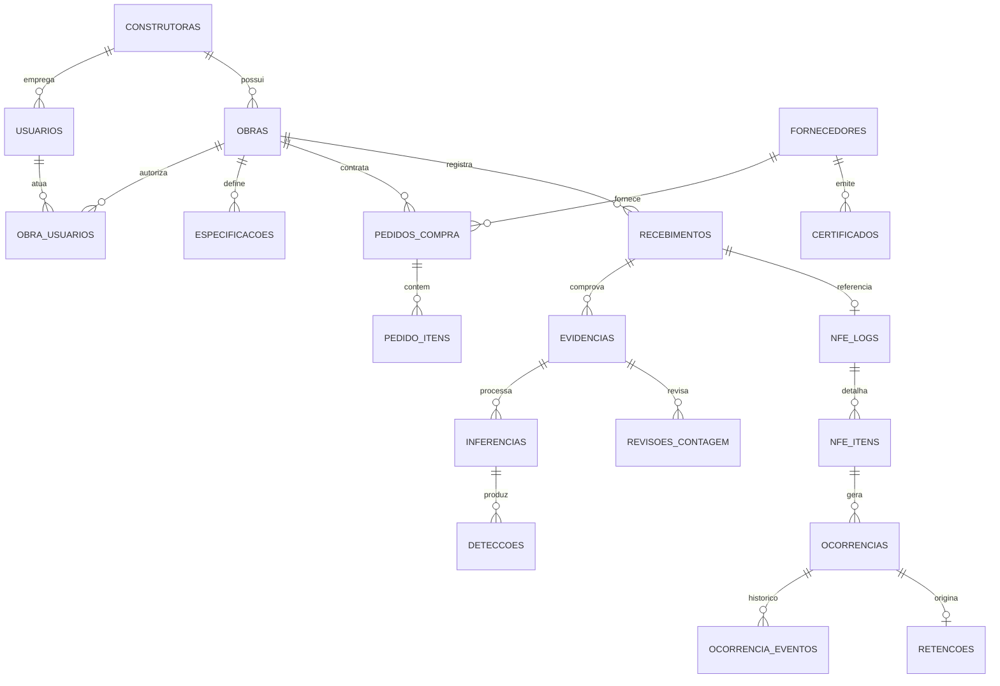

# stellSPY 2.0 — Modelo de Dados

> **Nenhuma migração foi criada ou executada.** O DDL abaixo é esboço de projeto, para revisão.
> Toda mudança proposta é **aditiva** — nenhuma coluna ou tabela existente é removida.

## 1. Schema atual (referência)

| Tabela | Colunas principais | Origem |
|--------|-------------------|--------|
| `obras` | `id`, `nome`, `cnpj_destinatario`, `aceita_similar`, `margem_tolerancia_float`, `modo_aprendizado`, `created_at` | `20260410120000` |
| `especificacoes` | `id`, `obra_id`, `material_tipo`, `bitola_mm`, `marca_exigida`, `qtd_planejada_metros`, `categoria_material`, `atributos_especificos`, `quantidade_prevista`, `unidade_prevista` | `20260410120000` + `20260414120000` (cimento) |
| `nfe_logs` | `id`, `chave_acesso`, `obra_id`, `status_conferencia`, `xml_data`, `override_info`, `processado_em`, `foto_url`, `laudo_pdf_url`, `resumo_global`, `itens_resumo`, `tipo`, `nf_original_id` | `20260410120000` + `…200000` + `…210000` + `…230000` |
| `nfe_itens` | `id`, `nfe_log_id`, `item_numero`, `material_recebido`, `bitola_recebida`, `marca_recebida`, `quantidade_recebida`, `unidade_recebida`, `status_item`, `divergencias`, `mensagem_item`, `especificacao_id` | `20260410210000` |
| `fila_nfe` | `id`, `obra_id`, `chave_acesso`, `tentativas`, `proxima_tentativa`, `status`, `ultimo_erro`, `notificado_aguardando` | `20260410120000` |
| `sinonimos` | `id`, `termo_nfe`, `material_padrao`, `confiabilidade` | `20260410120000` — **sem uso no código** |
| `normalizacao_materiais` | `id`, `categoria`, `nome`, `unidade_origem`, `unidade_destino`, `fator_conversao`, `parametros` | `20260414120000` — **sem uso no código** |

**Não existem:** `construtoras`, `usuarios`, `obra_usuarios`, `evidencias`, `recebimentos`,
`pedidos_compra`, `ocorrencias`, `retencoes`, `certificados`, `inferencias`, `auditoria`, `outbox`.

## 2. Modelo-alvo (ER simplificado)



## 3. Convenções do 2.0

| Convenção | Decisão | Motivo |
|-----------|---------|--------|
| PK | `uuid` com `gen_random_uuid()` | Já é o padrão do schema |
| Tenant | `tenant_id UUID NOT NULL` em todo agregado | RLS + isolamento |
| Timestamps | `criado_em`, `atualizado_em` (`TIMESTAMPTZ`, UTC) | Auditoria e sync |
| Autoria | `criado_por UUID REFERENCES usuarios` | Rastreabilidade nominal |
| Soft delete | `removido_em TIMESTAMPTZ NULL` apenas onde há obrigação de retenção | LGPD vs. auditoria |
| Dinheiro | `NUMERIC(14,2)`, nunca `float` | Precisão |
| Unidades | texto normalizado (`kg`, `m`, `sacos`, `pecas`) + fator na `normalizacao_materiais` | Multimaterial |
| JSONB | só para payload de integração/snapshot, **nunca** para campo consultável | Índices e integridade |

## 4. Novas tabelas — esboço de DDL

### 4.1 Identidade

```sql
-- ILUSTRATIVO — não executar
CREATE TABLE construtoras (
  id            UUID PRIMARY KEY DEFAULT gen_random_uuid(),
  nome          TEXT NOT NULL,
  cnpj          TEXT NOT NULL CHECK (cnpj ~ '^[0-9]{14}$'),
  slug          TEXT NOT NULL UNIQUE,
  plano         TEXT NOT NULL DEFAULT 'piloto'
                  CHECK (plano IN ('piloto','core','enterprise')),
  criado_em     TIMESTAMPTZ NOT NULL DEFAULT NOW()
);
CREATE UNIQUE INDEX uq_construtoras_cnpj ON construtoras (cnpj);

CREATE TABLE usuarios (
  id            UUID PRIMARY KEY DEFAULT gen_random_uuid(),
  tenant_id     UUID NOT NULL REFERENCES construtoras (id) ON DELETE CASCADE,
  nome          TEXT NOT NULL,
  email         TEXT NOT NULL,
  senha_hash    TEXT,                       -- NULL quando só login por magic link
  papel_global  TEXT NOT NULL DEFAULT 'fiscal'
                  CHECK (papel_global IN ('admin_tenant','engenheiro','fiscal','auditor')),
  ativo         BOOLEAN NOT NULL DEFAULT TRUE,
  ultimo_login  TIMESTAMPTZ,
  criado_em     TIMESTAMPTZ NOT NULL DEFAULT NOW()
);
CREATE UNIQUE INDEX uq_usuarios_email ON usuarios (lower(email));
CREATE INDEX idx_usuarios_tenant ON usuarios (tenant_id);

CREATE TABLE obra_usuarios (
  obra_id       UUID NOT NULL REFERENCES obras (id) ON DELETE CASCADE,
  usuario_id    UUID NOT NULL REFERENCES usuarios (id) ON DELETE CASCADE,
  papel         TEXT NOT NULL
                  CHECK (papel IN ('engenheiro','fiscal','auditor')),
  criado_em     TIMESTAMPTZ NOT NULL DEFAULT NOW(),
  PRIMARY KEY (obra_id, usuario_id)
);
```

**Por que `obra_usuarios` além de `papel_global`:** o fiscal da obra A não deve ver a obra B da mesma
construtora. O papel global define o teto; o vínculo por obra define o alcance.

### 4.2 Recebimento e evidência

```sql
-- ILUSTRATIVO — não executar
CREATE TABLE recebimentos (
  id              UUID PRIMARY KEY DEFAULT gen_random_uuid(),
  tenant_id       UUID NOT NULL REFERENCES construtoras (id),
  obra_id         UUID NOT NULL REFERENCES obras (id) ON DELETE CASCADE,
  nfe_log_id      UUID REFERENCES nfe_logs (id) ON DELETE SET NULL,
  pedido_id       UUID REFERENCES pedidos_compra (id) ON DELETE SET NULL,
  tipo            TEXT NOT NULL DEFAULT 'entrada'
                    CHECK (tipo IN ('entrada','devolucao','ajuste')),
  status          TEXT NOT NULL DEFAULT 'rascunho'
                    CHECK (status IN ('rascunho','em_conferencia','aguardando_revisao',
                                      'conferido','divergente','encerrado')),
  id_cliente      UUID,                      -- idempotência de sync offline
  capturado_em    TIMESTAMPTZ,               -- relógio do dispositivo (metadado)
  recebido_em     TIMESTAMPTZ NOT NULL DEFAULT NOW(),  -- relógio do servidor (verdade)
  placa_veiculo   TEXT,
  transportadora  TEXT,
  portaria        TEXT,
  observacoes     TEXT,
  criado_por      UUID REFERENCES usuarios (id),
  criado_em       TIMESTAMPTZ NOT NULL DEFAULT NOW(),
  atualizado_em   TIMESTAMPTZ NOT NULL DEFAULT NOW()
);
CREATE UNIQUE INDEX uq_recebimentos_id_cliente
  ON recebimentos (obra_id, id_cliente) WHERE id_cliente IS NOT NULL;
CREATE INDEX idx_recebimentos_obra_data ON recebimentos (obra_id, recebido_em DESC);

CREATE TABLE evidencias (
  id            UUID PRIMARY KEY DEFAULT gen_random_uuid(),
  tenant_id     UUID NOT NULL REFERENCES construtoras (id),
  recebimento_id UUID NOT NULL REFERENCES recebimentos (id) ON DELETE CASCADE,
  sha256        CHAR(64) NOT NULL,
  storage_key   TEXT NOT NULL,
  mime          TEXT NOT NULL,
  bytes         INT  NOT NULL CHECK (bytes > 0),
  largura       INT,
  altura        INT,
  origem        TEXT NOT NULL CHECK (origem IN ('camera','galeria','upload','integracao')),
  tipo          TEXT NOT NULL
                  CHECK (tipo IN ('material','etiqueta','nfe','lacre','documento')),
  capturada_em  TIMESTAMPTZ,
  criado_por    UUID REFERENCES usuarios (id),
  criado_em     TIMESTAMPTZ NOT NULL DEFAULT NOW(),
  removido_em   TIMESTAMPTZ,
  UNIQUE (recebimento_id, sha256)
);
CREATE INDEX idx_evidencias_rec ON evidencias (recebimento_id);
CREATE INDEX idx_evidencias_hash ON evidencias (tenant_id, sha256);
```

> O `UNIQUE (recebimento_id, sha256)` é o que impede a mesma foto ser usada como prova em dois
> recebimentos — controle antifraude de custo zero.

### 4.3 Pedido de compra

```sql
-- ILUSTRATIVO — não executar
CREATE TABLE fornecedores (
  id            UUID PRIMARY KEY DEFAULT gen_random_uuid(),
  tenant_id     UUID NOT NULL REFERENCES construtoras (id),
  cnpj          TEXT NOT NULL CHECK (cnpj ~ '^[0-9]{14}$'),
  razao_social  TEXT NOT NULL,
  nome_fantasia TEXT,
  criado_em     TIMESTAMPTZ NOT NULL DEFAULT NOW(),
  UNIQUE (tenant_id, cnpj)
);

CREATE TABLE pedidos_compra (
  id             UUID PRIMARY KEY DEFAULT gen_random_uuid(),
  tenant_id      UUID NOT NULL REFERENCES construtoras (id),
  obra_id        UUID NOT NULL REFERENCES obras (id) ON DELETE CASCADE,
  fornecedor_id  UUID NOT NULL REFERENCES fornecedores (id),
  numero         TEXT NOT NULL,
  status         TEXT NOT NULL DEFAULT 'aberto'
                   CHECK (status IN ('aberto','parcial','atendido','cancelado')),
  valor_total    NUMERIC(14,2),
  emitido_em     DATE,
  previsao_entrega DATE,
  erp_ref        TEXT,                      -- id no ERP de origem
  criado_em      TIMESTAMPTZ NOT NULL DEFAULT NOW(),
  UNIQUE (tenant_id, fornecedor_id, numero)
);

CREATE TABLE pedido_itens (
  id                UUID PRIMARY KEY DEFAULT gen_random_uuid(),
  pedido_id         UUID NOT NULL REFERENCES pedidos_compra (id) ON DELETE CASCADE,
  material_tipo     TEXT NOT NULL,
  categoria_material TEXT NOT NULL,
  bitola_mm         DOUBLE PRECISION,
  marca_exigida     TEXT,
  quantidade        NUMERIC(14,3) NOT NULL CHECK (quantidade > 0),
  unidade           TEXT NOT NULL,
  preco_unitario    NUMERIC(14,4),
  qtd_recebida      NUMERIC(14,3) NOT NULL DEFAULT 0,
  atributos         JSONB NOT NULL DEFAULT '{}'::jsonb
);
CREATE INDEX idx_pedido_itens_pedido ON pedido_itens (pedido_id);
```

**A diferença conceitual que o produto vende:** `especificacoes` é o que o projeto exige;
`pedido_itens` é o que a empresa contratou. O `conferente` atual compara com a primeira. O 2.0
compara com as duas e classifica a divergência por natureza (material errado × quantidade errada ×
preço diferente).

### 4.4 Ocorrência de divergência

```sql
-- ILUSTRATIVO — não executar
CREATE TABLE ocorrencias (
  id              UUID PRIMARY KEY DEFAULT gen_random_uuid(),
  tenant_id       UUID NOT NULL REFERENCES construtoras (id),
  recebimento_id  UUID NOT NULL REFERENCES recebimentos (id) ON DELETE CASCADE,
  nfe_item_id     UUID REFERENCES nfe_itens (id) ON DELETE SET NULL,
  tipo            TEXT NOT NULL
                    CHECK (tipo IN ('material_divergente','quantidade','marca','preco',
                                    'documento_ausente','certificado_vencido','avaria')),
  severidade      TEXT NOT NULL CHECK (severidade IN ('baixa','media','alta','critica')),
  status          TEXT NOT NULL DEFAULT 'aberta'
                    CHECK (status IN ('aberta','em_analise','resolvida','encerrada',
                                      'aceita_com_ressalva')),
  descricao       TEXT NOT NULL,
  valor_envolvido NUMERIC(14,2),
  responsavel_id  UUID REFERENCES usuarios (id),
  prazo           DATE,
  aberta_em       TIMESTAMPTZ NOT NULL DEFAULT NOW(),
  resolvida_em    TIMESTAMPTZ,
  criado_por      UUID REFERENCES usuarios (id)
);
CREATE INDEX idx_ocorrencias_tenant_status ON ocorrencias (tenant_id, status, severidade);

CREATE TABLE ocorrencia_eventos (
  id            UUID PRIMARY KEY DEFAULT gen_random_uuid(),
  ocorrencia_id UUID NOT NULL REFERENCES ocorrencias (id) ON DELETE CASCADE,
  tipo          TEXT NOT NULL,          -- 'criada','comentario','mudanca_status','decisao'
  de_status     TEXT,
  para_status   TEXT,
  texto         TEXT,
  autor_id      UUID REFERENCES usuarios (id),
  criado_em     TIMESTAMPTZ NOT NULL DEFAULT NOW()
);
```

**Regra de imutabilidade:** `ocorrencia_eventos` é *append-only* — nunca `UPDATE`, nunca `DELETE`.
É o que transforma "divergência" em auditoria de verdade.

### 4.5 Visão computacional

```sql
-- ILUSTRATIVO — não executar
CREATE TABLE inferencias (
  id                 UUID PRIMARY KEY DEFAULT gen_random_uuid(),
  evidencia_id       UUID NOT NULL REFERENCES evidencias (id) ON DELETE CASCADE,
  engine             TEXT NOT NULL,     -- 'roboflow-cloud' | 'roboflow-selfhosted' | 'local'
  modelo_id          TEXT NOT NULL,     -- 'steelspy-vergalhao/3'
  modelo_versao      TEXT NOT NULL,
  modelo_sha256      CHAR(64),          -- pesos, quando self-hosted
  parametros         JSONB NOT NULL DEFAULT '{}'::jsonb,
  parametros_hash    CHAR(64) NOT NULL,
  contagem_bruta     INT,
  confianca_mediana  DOUBLE PRECISION,
  confianca_p10      DOUBLE PRECISION,  -- pior decil: mede o "caso ruim"
  latencia_ms        INT,
  raw_hash           CHAR(64),
  erro               TEXT,
  criado_em          TIMESTAMPTZ NOT NULL DEFAULT NOW(),
  UNIQUE (evidencia_id, modelo_id, modelo_versao, parametros_hash)
);

CREATE TABLE deteccoes (
  id             BIGSERIAL PRIMARY KEY,
  inferencia_id  UUID NOT NULL REFERENCES inferencias (id) ON DELETE CASCADE,
  classe         TEXT NOT NULL,
  confianca      DOUBLE PRECISION NOT NULL CHECK (confianca BETWEEN 0 AND 1),
  bbox           JSONB NOT NULL,        -- [x1,y1,x2,y2]
  poligono       JSONB
);
CREATE INDEX idx_deteccoes_inferencia ON deteccoes (inferencia_id);

CREATE TABLE revisoes_contagem (
  id                 UUID PRIMARY KEY DEFAULT gen_random_uuid(),
  evidencia_id       UUID NOT NULL REFERENCES evidencias (id) ON DELETE CASCADE,
  inferencia_id      UUID REFERENCES inferencias (id),
  contagem_sugerida  INT,
  contagem_final     INT NOT NULL,
  modificada         BOOLEAN NOT NULL,
  motivo             TEXT,
  autor_id           UUID NOT NULL REFERENCES usuarios (id),
  criado_em          TIMESTAMPTZ NOT NULL DEFAULT NOW()
);
```

> `confianca_p10` existe porque **média engana**: 99 detecções a 0,99 e uma a 0,30 dão média 0,98.
> O percentil 10 é o que expõe o item duvidoso.

### 4.6 Auditoria e outbox

```sql
-- ILUSTRATIVO — não executar
CREATE TABLE auditoria (
  id          BIGSERIAL PRIMARY KEY,
  tenant_id   UUID NOT NULL,
  ator_id     UUID,                    -- NULL = sistema
  ator_tipo   TEXT NOT NULL CHECK (ator_tipo IN ('usuario','integracao','sistema')),
  entidade    TEXT NOT NULL,
  entidade_id UUID,
  acao        TEXT NOT NULL,           -- 'criou','alterou','aprovou','override','exportou'
  antes       JSONB,
  depois      JSONB,
  ip          INET,
  user_agent  TEXT,
  criado_em   TIMESTAMPTZ NOT NULL DEFAULT NOW()
);
CREATE INDEX idx_auditoria_tenant_data ON auditoria (tenant_id, criado_em DESC);

CREATE TABLE outbox (
  id            BIGSERIAL PRIMARY KEY,
  tenant_id     UUID NOT NULL,
  tipo          TEXT NOT NULL,
  payload       JSONB NOT NULL,
  status        TEXT NOT NULL DEFAULT 'pendente'
                  CHECK (status IN ('pendente','enviado','falha')),
  tentativas    INT NOT NULL DEFAULT 0,
  proxima_tentativa TIMESTAMPTZ NOT NULL DEFAULT NOW(),
  criado_em     TIMESTAMPTZ NOT NULL DEFAULT NOW()
);
CREATE INDEX idx_outbox_pend ON outbox (status, proxima_tentativa) WHERE status = 'pendente';
```

`auditoria` é *append-only* por política de banco (sem `UPDATE`/`DELETE` concedidos à role da API).

## 5. Migrações: estratégia expand–contract

Nenhuma migração destrutiva. Para cada mudança:

| Passo | Ação | Deployável isolado? |
|-------|------|---------------------|
| 1 | Adicionar coluna `NULL` / tabela nova | Sim |
| 2 | Backfill em lote (job, não migração) | Sim |
| 3 | Aplicar `NOT NULL` / constraint | Sim |
| 4 | Código passa a usar o novo campo | Sim |
| 5 | Remover campo antigo — **só depois de 2 releases** | Sim |

Numeração: seguir o padrão existente `YYYYMMDDHHMMSS_descricao.sql`, nunca editar migração já
aplicada.

### 5.1 Ordem de aplicação proposta (quando aprovado)

| Ordem | Migração | Depende de |
|-------|----------|------------|
| 1 | `construtoras` + `tenant_id` em `obras` (backfill: 1 construtora "default") | — |
| 2 | `usuarios`, `obra_usuarios` | 1 |
| 3 | `recebimentos` + `evidencias` | 1, 2 |
| 4 | `fornecedores`, `pedidos_compra`, `pedido_itens` | 1 |
| 5 | `ocorrencias`, `ocorrencia_eventos` | 3 |
| 6 | `inferencias`, `deteccoes`, `revisoes_contagem` | 3 |
| 7 | `auditoria`, `outbox`, `fila_trabalho` | 1 |
| 8 | Policies de RLS + role de aplicação | 1 |

**Passo 8 é obrigatório antes de qualquer segundo cliente.** Sem ele, `tenant_id` é só uma coluna.

## 6. Segurança de dados

| Item | Situação atual | Proposta |
|------|----------------|----------|
| `obras.api_key` | **plaintext** no banco, comparada com `compare_digest` | Guardar `sha256`/HMAC; exibir a chave **uma vez** na criação; rotação |
| Senha de usuário | não existe | `argon2id` (ou `scrypt` da stdlib) |
| Imagens | não existem | Storage privado + URL assinada de curta duração; **nunca** bucket público |
| Laudo PDF | bucket **público** (`laudo_storage.py`) | Bucket privado + assinatura; ou servir sempre pela API |
| PII em imagem | sem controle | Remoção de EXIF/GPS no upload; opção de *blur* de rostos |
| Segredos de ERP | não existem | Cifrados com chave de aplicação (KMS/env), nunca em texto |
| Log | sem `correlation_id` | `trace_id` por requisição e por job |

## 7. Retenção e expurgo (LGPD)

| Dado | Retenção padrão | Base |
|------|-----------------|------|
| `nfe_logs` / `nfe_itens` | 5 anos | Obrigação fiscal/contratual |
| `evidencias` (imagem) | 24 meses (configurável por contrato) | Necessidade probatória |
| `inferencias` / `deteccoes` | 24 meses | Reprodutibilidade da decisão |
| `auditoria` | 5 anos | Defesa jurídica |
| `outbox` enviado | 90 dias | Operacional |

Job de expurgo: apaga objeto no storage **e** marca `removido_em` na linha; o tombstone fica para
provar que existiu e quando.

## 8. Índices críticos (evitar dashboard lento)

| Consulta | Índice |
|----------|--------|
| Recebimentos por obra/período | `(obra_id, recebido_em DESC)` |
| Ocorrências abertas por tenant | `(tenant_id, status, severidade)` |
| Evidência por hash (dedupe) | `(tenant_id, sha256)` |
| Fila de trabalho | `(status, proxima_tentativa) WHERE status='pendente'` |
| Indicador de fornecedor | `(tenant_id, fornecedor_id, recebido_em)` em `recebimentos` |
| Auditoria por entidade | `(tenant_id, entidade, entidade_id)` |

## 9. O que este modelo deliberadamente não faz

- Não versiona `evidencias` (arquivo imutável não precisa de versão — o hash é a versão).
- Não usa `EAV` para atributos de material; `atributos_especificos` JSONB continua, mas campo
  consultável vira coluna.
- Não coloca preço em `nfe_itens` nesta fase (o XML pode não trazer; e preço é escopo de
  `pedido_itens`).
- Não implementa particionamento — desnecessário até ~10 M linhas.
