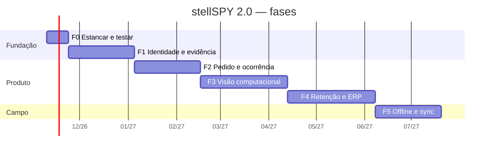
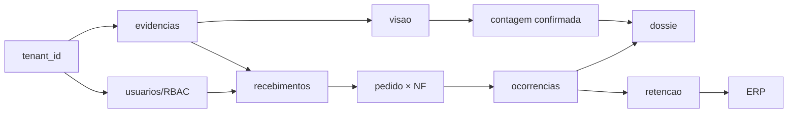

# stellSPY 2.0 — Roadmap e Estimativa de Complexidade

> Estimativas em **dias-dev** (≈6 h efetivas), para **1 desenvolvedor sênior** com apoio de IA e
> sem equipe de design/QA dedicada. Onde há incerteza, a faixa é explícita. Não inclui vendas,
> suporte nem campo.

## 1. Visão geral das fases

| Fase | Tema | Semanas | Dias-dev | Vendável ao fim? |
|------|------|---------|----------|------------------|
| **F0** | Estancar e testar | 1–2 | 8–10 | Não (dívida) |
| **F1** | Fundação: identidade, tenant, evidência | 3–8 | 25–30 | **Sim** — "auditoria com prova" |
| **F2** | Pedido de compra + ocorrência + dossiê | 9–14 | 20–25 | **Sim** — "auditoria de compra" |
| **F3** | Visão computacional + OCR restrito | 15–22 | 20–28 | **Sim** — "conferência assistida" |
| **F4** | Retenção, certificados, indicadores, ERP | 23–30 | 20–25 | **Sim** — "gestão de fornecedor" |
| **F5** | Offline completo e sincronização | 31–36 | 18–22 | Sim (requisito de campo) |
| | **Total** | **~36 semanas** | **111–140** | |

> A ordem **não** é negociável por conveniência comercial: cada fase depende da anterior. Vender F3
> antes de F1 significa prometer contagem sem ter onde guardar a foto.

## 2. Fase 0 — Estancar (1–2 semanas, 8–10 dd)

**Objetivo:** eliminar os riscos que tornariam qualquer fase seguinte insegura.

| Item | Complexidade | dd |
|------|--------------|-----|
| A1 — bloquear SSRF em `_carregar_imagem_url` (sem redirect) | S | 0,5 |
| A6 — carregar `.env` e falhar rápido sem `DATABASE_URL` | S | 0,5 |
| A2 — `modo_aprendizado` default OFF + migração de aviso | S | 0,5 |
| A3 — override consistente (status efetivo vs. calculado) | M | 2,0 |
| A4 — `tipo` na chave de idempotência | S | 1,0 |
| A5 — normalização de unidade em cimento/bloco | M | 2,0 |
| M1 — reaper da fila + `JSONDecodeError` | S | 1,0 |
| CI mínimo (pytest + build CSS) | S | 0,5 |
| `.gitignore` raiz + limpeza de `.pyc` órfãos | XS | 0,25 |
| Teto de versões + `tzdata` | XS | 0,25 |

**Saída:** nenhuma regressão funcional, build reprodutível, CI verde.
**Critério de saída:** 100% dos testes existentes passando em CI; nenhum achado A* em aberto.

## 3. Fase 1 — Fundação (6 semanas, 25–30 dd)

**Objetivo:** transformar um "app de uma obra" em **plataforma multiempresa com evidência**.

| Bloco | Itens | Complexidade | dd |
|-------|-------|--------------|-----|
| **Tenant** | `construtoras`, `tenant_id` em `obras`, backfill, role de app, policies RLS | L | 6–8 |
| **Identidade** | `usuarios`, `obra_usuarios`, login (cookie com claims), RBAC em `deps.py`, convite | L | 6–7 |
| **Evidência** | upload multipart, sha256, EXIF strip, storage, idempotência | L | 5–6 |
| **Recebimento** | entidade `recebimentos`, vínculo com `nfe_logs`, ciclo de status | M | 4–5 |
| **Testes** | TestClient + Postgres em container; contrato de isolamento por tenant | M | 3–4 |
| **PWA** | captura de foto, upload com progresso, retry | M | 3–4 |

**Saída vendável:** "cada recebimento tem foto datada, hash e responsável identificado".
**Critério de saída:**
- [ ] Teste automatizado prova que tenant A **não** lê dado de tenant B (query + RLS)
- [ ] Upload idempotente: 2 envios da mesma imagem = 1 evidência
- [ ] Toda escrita registra autor em `auditoria`
- [ ] Nenhuma rota antiga quebrada (`POST /conferir` responde igual)

## 4. Fase 2 — Pedido, ocorrência e dossiê (6 semanas, 20–25 dd)

| Bloco | Itens | Complexidade | dd |
|-------|-------|--------------|-----|
| **Pedido** | `fornecedores`, `pedidos_compra`, `pedido_itens`, importação (CSV/planilha) | L | 5–6 |
| **Conciliação** | motor NF × pedido × especificação; 3º eixo de divergência | L | 5–6 |
| **Ocorrência** | `ocorrencias` + `ocorrencia_eventos` (append-only), ciclo de vida, responsável | M | 4–5 |
| **Dossiê v1** | consolidação PDF: NF + pedido + evidências + ocorrências + assinaturas | M | 4–5 |
| **UI** | tela de divergências, filtros, atribuição | M | 2–3 |

**Saída vendável:** "eu sei o que pedi, o que chegou e o que divergiu — com dossiê para o fornecedor".
**Critério de saída:** 1 ciclo completo (pedido → recebimento → divergência → resolução) executado
sem intervenção manual no banco.

## 5. Fase 3 — Visão computacional (8 semanas, 20–28 dd) — **condicionada ao GO**

| Bloco | Itens | Complexidade | dd |
|-------|-------|--------------|-----|
| **Dataset** | coleta, anotação, versionamento, protocolo | L | 8–12 (inclui campo) |
| **Adaptador** | `VisionEngine`, engines cloud/self-hosted/mock, testes offline | M | 5–6 |
| **Fila e revisão** | `inferencias`, `deteccoes`, `revisoes_contagem`, tela de revisão | M | 4–5 |
| **Regra** | `contagem.py`: limiares, confiança p10, exige_revisao | S–M | 2–3 |
| **OCR restrito** | marca e tipo (não validade) | M | 2–3 |

**Saída vendável:** "conferência assistida de quantidade com revisão humana registrada".
**Critério de saída:** critérios S1–S6/R1–R6 de `../roboflow/ROBOFLOW_MODEL_EVALUATION.md` §6
atendidos em modo **assistido** no mínimo.

## 6. Fase 4 — Retenção, certificados, indicadores, ERP (8 semanas, 20–25 dd)

| Bloco | Itens | Complexidade | dd |
|-------|-------|--------------|-----|
| **Retenção** | solicitação, aprovação, histórico, notificação | M | 4–5 |
| **Certificados** | registro, validade, vínculo com fornecedor/material, alerta de vencimento | M | 4–5 |
| **Indicadores** | consolidação por fornecedor (prazo, divergência, reincidência) | M | 3–4 |
| **ERP** | porta `ErpAdapter` + `CsvAdapter` + 1 conector real + outbox | L | 7–9 |
| **Dashboard** | migrar Streamlit → telas do produto (ou manter interno) | S | 2 |

**Saída vendável:** "retenção solicitada com rastro" + "ranking de fornecedores".
**Critério de saída:** nenhuma integração consegue aprovar ou liberar pagamento — só **solicitar**.

## 7. Fase 5 — Offline e sincronização (6 semanas, 18–22 dd)

| Bloco | Itens | Complexidade | dd |
|-------|-------|--------------|-----|
| **PWA** | IndexedDB, fila local, retomada, indicador de pendências | L | 8–10 |
| **Sync** | `POST /sync` em lote, `id_cliente`, resposta por operação | M | 4–5 |
| **Conflito** | política servidor/cliente, tela de conflito | M | 3–4 |
| **Resiliência** | testes de caos de reconexão | M | 3 |

**Critério de saída:** 50 recebimentos criados offline, sincronizados em 3 redes diferentes, **zero
duplicata** e **zero perda**.

## 8. Estimativa consolidada por natureza de trabalho

| Natureza | dd | % |
|----------|-----|---|
| Banco/migrações | 18–22 | 15% |
| Backend (domínio + serviços) | 38–48 | 33% |
| Frontend/PWA | 22–28 | 19% |
| Testes e CI | 12–16 | 10% |
| Integrações (WhatsApp, ERP, CV) | 12–16 | 10% |
| Campo/anotação (Fase 3) | 8–12 | 8% |
| Infra/observabilidade | 5–8 | 5% |
| **Total** | **115–150** | |

## 9. Caminho crítico e dependências

Bloqueios que costumam ser subestimados:

1. **RLS só vale com role de aplicação.** Sem trocar a credencial, `tenant_id` é decorativo.
2. **Testes de isolamento precisam existir antes do 2º cliente** — depois é retrofit caro.
3. **`id_cliente` deve nascer junto com `recebimentos`**, não na Fase 5; caso contrário o offline
   exige migrar dados já em produção.
4. **Versionamento de modelo deve nascer com `inferencias`**, não depois — sem isso não há
   reprodutibilidade retroativa.

## 10. O que **não** fazer em cada fase

| Fase | Não fazer |
|------|-----------|
| F0 | Refatorar `conferente.py`; adicionar funcionalidade nova |
| F1 | Visão computacional; ERP; dashboard novo |
| F2 | OCR; retenção financeira; multi-idioma |
| F3 | Contagem autônoma sem revisão; VLM |
| F4 | Qualquer ação que libere/bloqueie pagamento automaticamente |
| F5 | Inferência no dispositivo (é Fase 6+, se algum dia) |

## 11. Incertezas que afetam o prazo (declaradas)

| Incerteza | Impacto no prazo |
|-----------|------------------|
| GO/NO-GO de visão computacional | ±8 semanas (Fase 3 pode encolher ou desaparecer) |
| Escolha do ERP do primeiro cliente | ±2 semanas (conector é feito sob medida) |
| Exigência de RLS com auditoria externa | +1–2 semanas |
| Necessidade de app nativo para offline | +6–8 semanas (hoje fora de escopo) |
| Disponibilidade de obras para coleta | ±3 semanas na Fase 3 |

Como a estimativa tem ±25% de erro natural, comunicar **faixa**, nunca número único.
