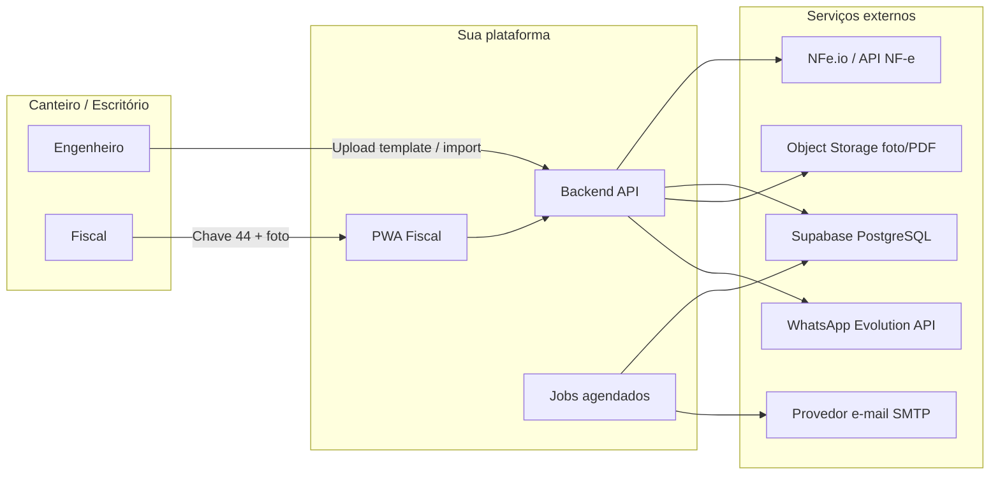
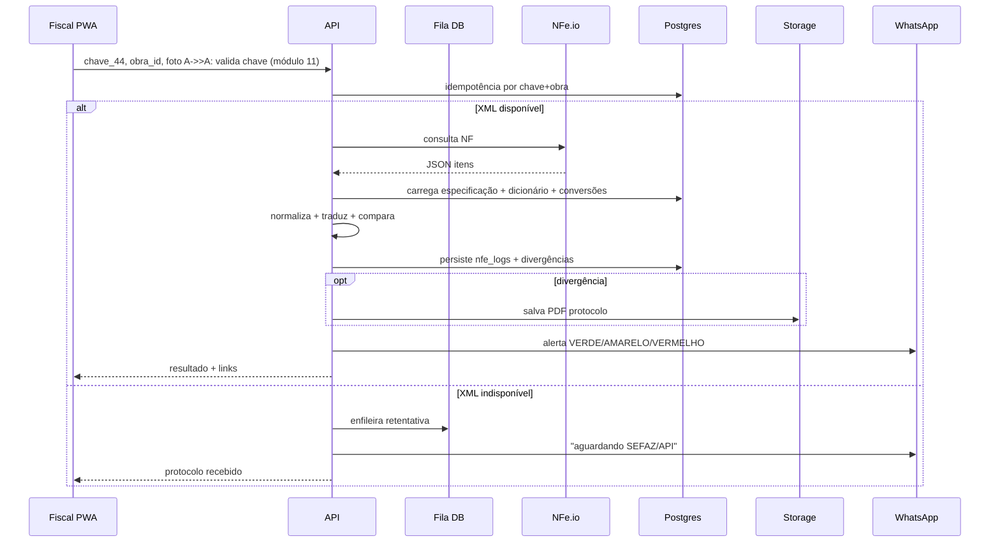
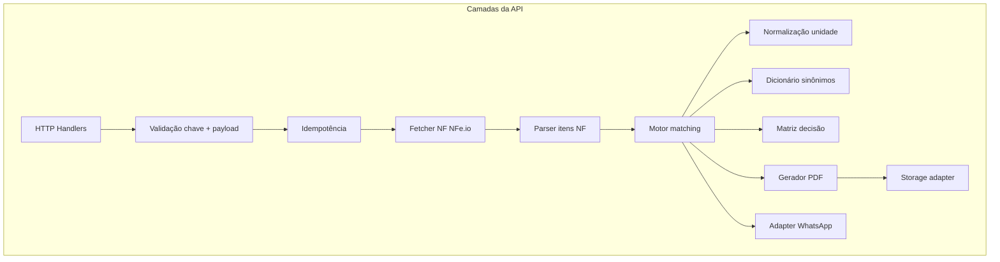
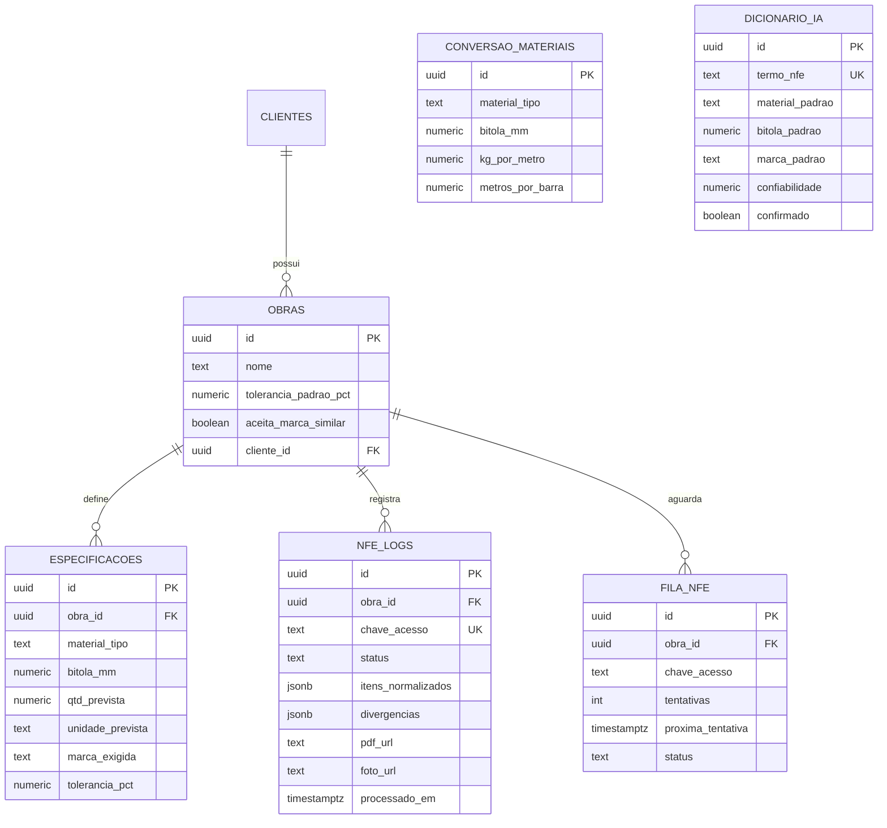

# Arquitetura — Conferência NF × Especificação (Aço / Concreto)

Documento de referência para o MVP (piloto pago) e evolução controlada.  
**Objetivo:** comparar itens da NF (fonte estruturada) com a especificação da obra, normalizar unidades, aplicar sinônimos e entregar decisão **VERDE / AMARELO / VERMELHO** com rastro auditável.

---

## 1. Visão de contexto (C4 Nível 1)

**Conclusão de negócio:** o valor não está na “IA genérica”, e sim na **cadeia confiável**: especificação versionada → dados estruturados da NF → normalização → regras → evidência (PDF) → hábito (WhatsApp).

---

## 2. Contêineres (C4 Nível 2)

| Contêiner | Responsabilidade | Stack sugerida (MVP) |
|-----------|------------------|----------------------|
| **PWA** | Fiscal digita chave, anexa foto; opcional admin confirma sinônimos | HTML/CSS/JS mínimo ou Next.js |
| **API** | Orquestra conferência, idempotência, gera PDF, dispara alertas | Python **FastAPI** ou Node |
| **Worker / Cron** | Retentativa XML indisponível, relatório semanal CSV | Mesmo runtime + scheduler (Render cron, GitHub Actions, ou worker queue) |
| **Banco** | Obras, especificações, logs, dicionário, fila | **Supabase** (Postgres + RLS) |
| **Storage** | Fotos e PDFs imutáveis | Supabase Storage, S3, ou Cloudflare R2 |
| **Integrações** | NF-e por chave, WhatsApp, e-mail | NFe.io, Evolution API, SMTP |

**Conclusão técnica:** um único serviço **stateless** (API) + **banco transacional** + **storage de objetos** + **jobs** cobre o MVP sem microserviços.

---

## 3. Fluxo principal — `POST /conferir`

**Conclusão operacional:** a **fila com retentativa** é tão importante quanto o comparador — sem ela, o fiscal abandona na primeira NF “fresca”.

---

## 4. Componentes internos da API

### 4.1 Motor de matching (regras)

Ordem sugerida de severidade (ajustável por obra):

1. **Classe / tipo** (ex.: CA-50 vs CA-60) → divergência estrutural → tendência a **VERMELHO**.
2. **Bitola** → idem.
3. **Marca** → conforme `aceita_similar` / fornecedores permitidos.
4. **Quantidade** → tolerância % (obra ou linha da especificação).

**AMARELO:** apenas aviso (ex.: dentro de faixa “atenção”, marca limítrofe, quantidade no limiar).

**Conclusão de produto:** priorizar **erro estrutural** na mensagem; quantidade “quase no limite” não pode roubar o protagonismo do aço errado.

---

## 5. Modelo de dados (lógico)

Entidades mínimas (nomes podem variar; relações são o contrato):

**Seed obrigatório:** tabela `CONVERSAO_MATERIAIS` (pesos ABNT por bitola) + sinônimos iniciais (“ACO CA50”, “VERGALHAO”, marcas).

**Conclusão de dados:** o **dicionário** e a **conversão** são ativos do negócio — versionados e auditáveis; sem eles não escala para múltiplas obras.

---

## 6. Integrações — contratos e riscos

###6.1 NFe.io (ou equivalente)

- **Entrada:** chave 44 válida.
- **Saída:** JSON com itens; falhas temporárias → fila.
- **Risco:** descrição de produto pobre → matching depende mais do dicionário; mitigação: confirmação única e relatório de “itens não classificados”.

### 6.2 WhatsApp (Evolution API)

- **Entrada:** texto + opcional mídia (foto já armazenada ou link).
- **Risco:** instabilidade/ban — mitigação: log de entrega, retry, e **mesmo resultado** disponível no PWA.

### 6.3 E-mail (relatório semanal)

- **Job** agrega `nfe_logs` da semana, monta CSV, anexa, envia para e-mails cadastrados na obra/cliente.

---

## 7. Segurança e compliance (MVP “sério”)

- **RLS** no Supabase por `cliente_id` / `obra_id` (evitar vazamento entre construtoras).
- **Validação da chave** (algoritmo módulo 11 da NF-e).
- **Segredos** apenas em variáveis de ambiente; rotação de tokens NFe/Evolution.
- **LGPD:** política de retenção (ex.: foto/PDF 24–36 meses ou conforme contrato), base legal, exclusão sob solicitação do cliente.
- **Rate limiting** em `/conferir` por obra e por IP.

**Conclusão jurídica-comercial:** o PDF é **evidência de diligência**, não substitui assessoria jurídica — texto de termos deve ser revisado por advogado antes de escalar.

---

## 8. Observabilidade

- **Logs estruturados** por `correlation_id` (uma conferência).
- **Métricas:** latência NFe.io, taxa de fila, % VERMELHO/AMARELO, **taxa de falso positivo** (flag humano).
- **Alertas:** fila crescendo, falha Evolution > N%, NFe.io erro 5xx sustentado.

---

## 9. Ambientes e deploy

| Ambiente | Uso |
|----------|-----|
| `dev` | testes com NFs sanitizadas |
| `staging` | obra parceira limitada |
| `prod` | piloto pago |

**Hospedagem MVP:** API + worker no **Render** ou **Fly.io**; Supabase gerenciado; storage compatível.

---

## 10. Roadmap técnico alinhado ao negócio

| Fase | Escopo | Objetivo |
|------|--------|----------|
| **MVP (0–2 sem)** | Chave + XML + regras + WhatsApp + PDF + CSV semanal | Piloto pago, &lt;2% falso positivo |
| **Fase 2** | OCR chave na foto, offline IndexedDB, manifestação | Menos atrito no canteiro + compliance fiscal |
| **Fase 3** | Dashboard economia, APIs ERP | Expansão de conta (LTV) |

---

## 11. Conclusão executiva (o que estamos construindo)

1. **Produto:** um **auditor de entrada** especializado em **aço/concreto**, não um ERP.
2. **Arquitetura:** monólito modular (API + jobs) + Postgres + storage + 3 integrações; **sem** microserviços no piloto.
3. **Diferencial técnico defensável:** **normalização + sinônimos com confirmação + idempotência + PDF** — não só “IA leu a nota”.
4. **Maior risco:** **falso positivo** → mitigado por thresholds, ordem de severidade, e fila para XML.
5. **Próximo passo de implementação:** implementar na ordem **Dados (Supabase + seed) → NFe.io → comparador → WhatsApp → PDF → PWA → relatório**.

---

*Versão: 1.0 — alinhada ao backlog de 2 semanas e critérios de aceite do MVP.*
