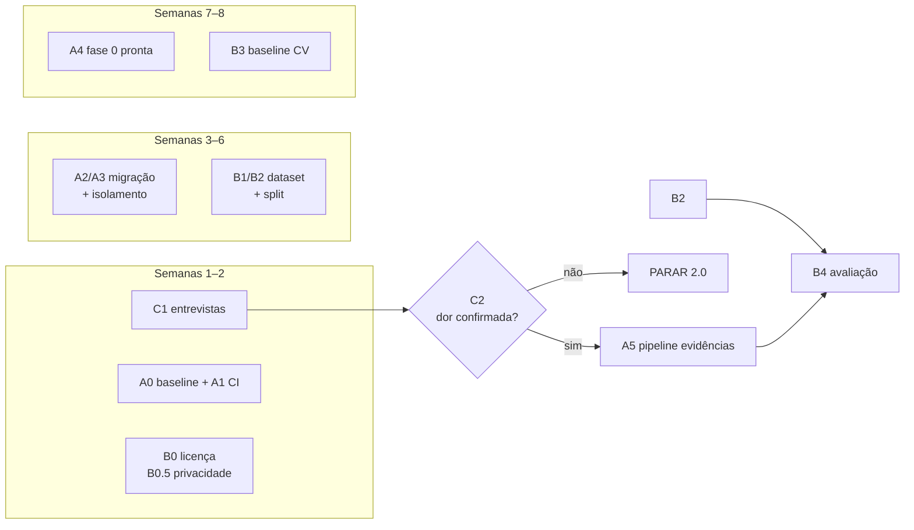

# MATRIZ GO/NO-GO — Execução Controlada

> **Fonte de verdade preservada:** `PLANO_STELLSPY_2.0.md`, `docs/roboflow/ROBOFLOW_FEASIBILITY.md`,
> `docs/roboflow/ROBOFLOW_MODEL_EVALUATION.md`. As cinco descobertas e as decisões GO/NO-GO anteriores
> **não foram alteradas**; este documento apenas as transforma em gates executáveis.
>
> **Status de verificação:** análise estática. Nada executado — shell indisponível na sessão
> (`SetNamedSecurityInfoW failed (Win32 5): grantWrite(C:\Naturecode\stellSPY)`).

---

## 1. Como esta matriz funciona

- Cada gate tem **evidência exigida**. Sem a evidência, o gate está **fechado**, mesmo que o trabalho
  "pareça pronto".
- Gate fechado **bloqueia a fase seguinte**, não a fase atual.
- Evidência = artefato anexável (log de CI, print, consulta SQL, arquivo versionado). "Eu rodei aqui"
  não é evidência.
- Qualquer critério na coluna **NO-GO** encerra a linha de trabalho — não se "ajusta o critério".

---

## 2. Gates da trilha comercial

| ID | Gate | Evidência | Bloqueia |
|----|------|-----------|----------|
| **C1** | 10 entrevistas realizadas e pontuadas | `RELATORIO_ENTREVISTAS.md` com 10 linhas e scores | Fase 1 (evidência/upload) |
| **C2** | Critérios E1–E7 atendidos | tabela preenchida com veredito | Fase 1 |
| **C3** | Piloto pago assinado (R$ 490/mês, 60 dias) | contrato ou e-mail de aceite + 1º pagamento | Fase 2 (pedido/ocorrência) |

### 2.1 Decide C1/C2

| Resultado | Ação |
|-----------|------|
| C1 CONTINUA e C2 CONTINUA | Seguir para Fase 1 |
| Dor existe, compra incerta | Refazer ICP; **não** escrever código |
| C1 PARA | **Parar o 2.0**; reavaliar produto |
| C2 PARA mas C1 CONTINUA | Rodar E3 (piloto pago) antes de qualquer Fase 1 |

> **Regra dura:** Fase 1 **não começa** sem C1 e C2. Construir upload antes de confirmar a dor é o
> erro mais caro do roadmap.

---

## 3. Gates da Trilha A (fundação)

| ID | Gate | Evidência | Bloqueia |
|----|------|-----------|----------|
| **A0** | Baseline executável registrado | saída de `pytest`, `pip freeze`, `git status` arquivadas | qualquer migração |
| **A1** | CI verde (testes + build CSS + gate de licença) | log do CI | merge de migração |
| **A2** | Migrações M1–M4 aplicadas em **staging**, idempotentes | log de 2 execuções + `\dt` | produção |
| **A3** | Isolamento provado (I1–I6) | log dos testes + `SELECT rolbypassrls` | 2º tenant |
| **A4** | Fase 0 concluída (AC0.1–AC0.10) | checklist assinado | Fase 1 |
| **A5** | Pipeline de evidências (AC1.1–AC1.13) | checklist + inspeção de bucket | Fase 2 / Trilha B em obra |

### 3.1 Teste de mutação do isolamento (obrigatório)

O gate A3 só vale se **I6** existir: remover a policy de RLS deve **quebrar** o teste. Sem isso, o teste
verde prova apenas que a aplicação filtra por `tenant_id` — não que o banco protege.

---

## 4. Gates da Trilha B (visão computacional)

| ID | Gate | Evidência | Bloqueia |
|----|------|-----------|----------|
| **B0** | Licença verificada: sem AGPL; `inference` inspecionado; RF-DETR Apache-2.0 | `LICENSING_GATE.md` LG1, LG3, LG7 | qualquer instalação/treino |
| **B0.5** | Privacidade configurada: "Data Licensing and Model Training" **desligado** + print | `docs/legal/roboflow-config/` (LG6) | qualquer upload |
| **B1** | Dataset congelado e registrado (licença por dataset, hash do manifest) | LG4 + `split-v1.json` | treino |
| **B2** | Split por entrega validado (3 obras no teste, ≥ 18 entregas) | relatório de split | avaliação |
| **B3** | Baseline OpenCV medido | tabela de MAE/MAPE do B0 | treino (é o piso de comparação) |
| **B4** | Avaliação cega concluída, R1–R6 / S1–S6 preenchidos | relatório com critérios assinados | integração |
| **B5** | Decisão de produto por categoria | ADR: entra autônomo / assistido / não entra | Fase 3 |

### 4.1 Decide B4/B5

| Resultado | Ação |
|-----------|------|
| Todos na faixa GO | Integrar em modo autônomo com revisão amostral |
| 1–2 intermediários | **PIVOT** → modo assistido obrigatório (aceitável, não é fracasso) |
| Qualquer NO-GO | Não integrar a categoria; manter baseline clássico se ele performar |

> **Nenhum número de benchmark genérico (COCO/mAP público) pode ser usado como evidência de B2/B4.**
> Só contam as métricas medidas no nosso conjunto, por entrega, com anotador cego.

---

## 5. Matriz consolidada

| Gate | Trilha | Depende de | Evidência-chave | Bloqueia |
|------|--------|-----------|-----------------|----------|
| C1 | Comercial | — | 10 entrevistas | A5/Fase 1 |
| C2 | Comercial | C1 | E1–E7 | Fase 1 |
| A0 | A | — | log de baseline | A2 |
| A1 | A | A0 | CI verde | A2 |
| A2 | A | A1 | migração em staging | A3 |
| A3 | A | A2 | I1–I6 + `rolbypassrls=false` | 2º tenant |
| A4 | A | A3 | AC0.1–AC0.10 | Fase 1 |
| A5 | A | A4 + C2 | AC1.1–AC1.13 | Fase 2 / B em campo |
| B0 | B | — | LG1, LG3, LG7 | B1 |
| B0.5 | B | — | print do setting (LG6) | upload |
| B1 | B | B0, B0.5 | manifest + registro de licença | B2 |
| B2 | B | B1 | split por entrega | B4 |
| B3 | B | B1 | baseline OpenCV | B4 |
| B4 | B | B2, B3 | R1–R6 / S1–S6 | B5 |
| B5 | B | B4 | ADR | Fase 3 |
| C3 | Comercial | A5 | contrato + pagamento | Fase 2 |

---

## 6. Paralelismo permitido



**Podem rodar em paralelo:** C1, A0/A1 e B0/B0.5 (não competem por recurso).
**Não podem:** A2 sem A1; B1 sem B0/B0.5; B4 sem A5 (a avaliação precisa de imagens no pipeline).

O gargalo real da Trilha B é **coleta e anotação** — começar cedo, mesmo enquanto C1 roda.

---

## 7. Paradas obrigatórias (hard stops)

| # | Condição | Ação | Quem |
|---|----------|------|------|
| HS1 | C2 na coluna PARA | Interromper o 2.0; reavaliar produto | Fundador |
| HS2 | B0.5 não documentado | **Proibir** qualquer upload de imagem para a Roboflow | Técnico |
| HS3 | `ultralytics`/YOLO detectado (direto ou transitivo) | Parar; abrir ADR de exceção; não instalar | Técnico |
| HS4 | Teste I6 não existe ou não falha | Não criar 2º tenant; não vender multiempresa | Técnico |
| HS5 | Critério NO-GO em B4 | Não integrar visão; não prometer contagem | Fundador |
| HS6 | Ground truth usado = quantidade da NF-e | Invalidar experimento inteiro; refazer | Técnico |
| HS7 | Dataset com licença BY-NC ou sem licença | Excluir do treino imediatamente | Técnico |
| HS8 | Qualquer tentativa de rodar migração em produção nesta etapa | Bloquear | Técnico |

---

## 8. Dependências

### 8.1 Bloqueantes (sem elas, nada anda)

| # | Dependência | Trilha | Status |
|---|-------------|--------|--------|
| D1 | **Shell/comandos funcionais** no ambiente de trabalho | todas | ❌ **bloqueado hoje** (ACL) |
| D2 | Postgres acessível para testes | A | ⏳ não verificado |
| D3 | Docker (se opção container) | A | ⏳ não verificado |
| D4 | Aprovação do plano de migração | A | ⏳ **decisão pendente** |
| D5 | 10 entrevistados recrutados | Comercial | ⏳ |
| D6 | Conta Roboflow Free criada | B | ⏳ |
| D7 | Imagens autorizadas coletadas (600 + 600) | B | ⏳ depende de obra parceira |
| D8 | Termo de uso de imagem assinado | B | ⏳ |

### 8.2 Não bloqueantes, mas condicionam prazo

| # | Dependência | Impacto |
|---|-------------|---------|
| D9 | CNPJ real da construtora padrão | Bloqueia só o 2º tenant (AC0.10) |
| D10 | Pessoa para dupla anotação | +20–30 h na Trilha B |
| D11 | Obra parceira para coleta em 3 cenários de luz | +2 semanas se falhar |

### 8.3 Correção de D1 (caminho sugerido)

O erro é de ACL do workspace, não do projeto. Caminho: skill
`diagnose-windows-sandbox-acl` (inspeciona a ACL do caminho e dos ancestrais e repara o que for
provado). Alternativa: rodar a sessão com política de escrita mais ampla, ou trabalhar em cópia do
repositório em caminho de usuário.

> **Sem D1, todo o restante é planejamento.** Isso precisa ser a primeira coisa resolvida.

---

## 9. Estimativa de esforço

| Bloco | Escopo | Esforço | Custo monetário |
|-------|--------|---------|-----------------|
| Comercial — 10 entrevistas | recrutar, entrevistar, relatório | 23 h (≈ 4 dd) | R$ 0 |
| A0 — baseline + correções A1/A2/A6/M1 | ver `PLANO_EXECUCAO_FASE0.md` | 5 dd | R$ 0 |
| A1 — CI + gate de licença | — | 1 dd | R$ 0 |
| A2/A3 — migração + RLS + isolamento | — | 8 dd | R$ 0 |
| A2' — usuários, RBAC, sessão com claims | — | 4 dd | R$ 0 |
| A3' — correções A3/A4/A5 | — | 5 dd | R$ 0 |
| **Fase 0 total** | | **24 dd (+30% → 31 dd)** | R$ 0 |
| A5 — pipeline de evidências (Fase 1) | `PLANO_PIPELINE_EVIDENCIAS.md` | **21 dd (+30% → 27 dd)** | R$ 0 |
| B0/B0.5 — licença + privacidade | inspeção, configuração, prints | 1 dd | R$ 0 |
| B1/B2 — dataset + split | coleta, anotação, QA | 12–15 dd | R$ 0 |
| B3 — baseline CV | OpenCV | 2 dd | R$ 0 |
| B4 — avaliação | treinos + relatório | 5 dd | R$ 0 (Free Tier) |
| **Trilha B total** | | **20–23 dd** | **US$ 0** |

### 9.1 Resumo por horizonte

| Horizonte | Entrega | dd |
|-----------|---------|-----|
| 2 semanas | C1 + A0/A1 + B0 | 10 |
| 6 semanas | A2/A3 + B1/B2 | 27 |
| 10 semanas | Fase 0 completa (A4) + B3 | 31 + 8 |
| 14 semanas | A5 (Fase 1) + B4/B5 | +27 |

**Ritmo assumido:** 1 pessoa, 4,5 dias produtivos/semana. Incerteza ±25%.

---

## 10. Riscos (delta em relação ao plano anterior)

Além dos 28 riscos de `docs/2.0/RISCOS_E_PLANO_DE_TESTES.md`, a etapa de preparação introduz riscos
próprios:

| ID | Risco | P | I | Score | Mitigação |
|----|-------|---|---|-------|-----------|
| R29 | **Documentação vira substituto de execução** ("achamos que resolvemos") | 4 | 4 | **16** | Cada gate exige artefato; este documento não vale como entrega |
| R30 | Gate de licença virar teatro (passa sempre porque ninguém o quebra) | 3 | 5 | **15** | HS3 + teste do próprio gate (criar dependência proibida de propósito e ver falhar) |
| R31 | Fase 0 cresce e vira "reescrita disfarçada" | 4 | 4 | **16** | Escopo fechado em `PLANO_EXECUCAO_FASE0.md` §7; proibido tocar `conferente.py` |
| R32 | Entrevistas enviesadas por rede do fundador | 4 | 3 | 12 | Máx. 4 de 10 da rede direta; registro no relatório |
| R33 | Coleta de imagens não autorizada em 2 semanas | 3 | 4 | 12 | D8 antes de D7; alternativa: material próprio em pátio |
| R34 | Ambiente sem shell/ACL impede tudo | 5 | 5 | **25** | Resolver D1 primeiro; é o único risco que zera o resto |
| R35 | `inference` traz AGPL transitivo | 3 | 5 | **15** | B0 obrigatório + usar `rfdetr` puro |
| R36 | Split por entrega mal feito (vazamento) | 3 | 5 | **15** | B2 com checklist + revisão por terceiro |

Top 3 agora: **R34** (ambiente), **R29** (planejar ≠ executar), **R31** (escopo da Fase 0).

---

## 11. Critérios de aceite desta etapa de preparação

Esta etapa (documentação) está concluída quando:

| ID | Critério | Status |
|----|----------|--------|
| P1 | 6 entregáveis produzidos | ✅ |
| P2 | Baseline estático verificável registrado | ✅ (§1 do Fase 0) |
| P3 | Baseline **executável** registrado (pytest, pip freeze, git status) | ❌ **pendente — shell** |
| P4 | Plano de migração com ordem, rollback e AC | ✅ |
| P5 | Critérios de aceite mensuráveis para Fase 0 e Fase 1 | ✅ (AC0.x, AC1.x) |
| P6 | Protocolo do experimento com métricas e splits pré-registrados | ✅ |
| P7 | Gate de licença especificado, com estado atual verificado | ✅ (com 2 pendências de verificação) |
| P8 | Roteiro de entrevistas com critérios de decisão pré-registrados | ✅ |
| P9 | Nenhum arquivo existente alterado | ✅ (apenas arquivos novos) |
| P10 | Nenhuma execução declarada como feita | ✅ |

> **P3 é o único item vermelho** — e é o que autoriza começar a implementação.

---

## 12. Próxima decisão necessária

> ### DECISÃO #1 (bloqueia tudo): **aprovar a implementação da Fase 0 e resolver o acesso ao shell.**
>
> O plano de migração e os critérios de aceite foram apresentados, como a diretriz exigia
> ("não implementar antes de apresentar plano de migração e critérios de aceite"). A condição está
> satisfeita. Falta a autorização — e um ambiente onde os comandos rodem.

Em ordem de desbloqueio:

| Ordem | Decisão | Quem decide | Destrava |
|-------|---------|-------------|----------|
| **1** | **Autorizar a Fase 0** (A0→A4) e corrigir o acesso ao shell | Fundador | 31 dd de trabalho; todos os gates A |
| **2** | Autorizar criação da conta Free Roboflow + desligar "Data Licensing and Model Training" + arquivar print | Fundador + jurídico | B0.5, B1 (coleta) |
| **3** | Aprovar a coleta de imagens (termo + obra parceira) | Fundador | B1, B2 (gargalo da Trilha B) |
| **4** | Agendar as 10 entrevistas (iniciar recrutamento hoje) | Fundador | C1, C2, e a própria continuidade do 2.0 |

**Decisão #4 é a única que pode invalidar todo o resto** — e é a mais barata (R$ 0, 23 h). Se a dor não
se confirmar, 31 dd de Fase 0 viram desperdício.

### Recomendação de sequência

```
Hoje          → resolver shell (D1) + iniciar recrutamento das 10 entrevistas
Semana 1–2    → C1 rodando  ‖  A0/A1 (baseline + CI)  ‖  B0 (licença)
Semana 2      → gate C2: dor confirmada?
                 ├─ não → parar; reavaliar produto
                 └─ sim → A2/A3 (migração + isolamento)
Semana 3–6    → A4 (Fase 0)  ‖  B1/B2 (dataset)
Semana 7+     → A5 (evidências) → Fase 1 vendável
```

---

## 13. Declaração de estado (honestidade sobre o que foi feito)

| Afirmação | Verificado? |
|-----------|-------------|
| 6 documentos produzidos | ✅ sim (arquivos existem) |
| Nenhum código de produto alterado | ✅ sim (apenas `.md` criados) |
| Baseline estático (8 endpoints, 7 tabelas, 9 migrações, 65 funções, 69 casos, 38 env vars) | ✅ por leitura/grep |
| Testes passam | ❌ **não executado** |
| Docker/Postgres disponíveis | ❌ **não verificado** |
| Árvore de dependências do `inference` | ❌ **não verificada** |
| Licenças LGPL confirmadas por metadados | ❌ **não verificado** |
| Nenhuma conta Roboflow criada | ✅ sim |
| Nenhuma migração executada | ✅ sim |
| Nenhum deploy | ✅ sim |

**Este pacote é preparação, não execução.** Nenhum gate desta matriz estava aberto.

---

## 14. REVISÃO — Sprint de Engenharia 0 (2026-11-03)

> Esta seção **substitui** os status das §1–§13. Os números daquelas seções eram estáticos; agora há
> execução. Fontes: `EVIDENCIAS.md`, `RELATORIO_TESTES.md`, `STATUS_EXECUCAO.md`.

### 14.1 O que mudou

| Antes (análise estática) | Agora (execução real) |
|--------------------------|----------------------|
| Shell indisponível | ✅ reparado (`WRITE_OWNER` ausente) e testado |
| 69 casos *previstos* | ✅ **69 aprovados**, 1,75 s |
| `tzdata` como hipótese (M6) | ⚠️ **confirmado** — a suíte não coleta sem ele |
| Git sem menção | 🔴 **zero commits** — achado novo e crítico |
| Postgres "não verificado" | ✅ Docker funciona; imagens locais presentes |
| Fase 0 aguardando aprovação | 🔴 **bloqueada por 2 gates técnicos** |

### 14.2 Matriz de gates revisada

| Gate | Critério | Evidência | Status |
|------|----------|-----------|--------|
| **G-01** | Ambiente de execução disponível | E1: reparo verificado, comandos executam | 🟢 **ABERTO** |
| **G-02** | Baseline executável | E6: 69/69 aprovados | 🟢 **ABERTO** (com ressalva) |
| **G-03** | Baseline reprodutível em máquina limpa | E5: falha sem `tzdata` | 🟡 **PARCIAL** |
| **G-04** | Controle de versão utilizável | E3: `git rev-parse HEAD` → fatal | 🔴 **FECHADO** |
| **G-05** | Dependências declaradas completas | E5: `tzdata` ausente | 🔴 **FECHADO** |
| **G-06** | Fase 0 autorizada | depende de G-04 e G-05 | 🔴 **FECHADO** |
| **G-07** | Gate de licença como automação | `LICENSING_GATE.md` §4 — script não criado | 🔴 **FECHADO** |
| **G-08** | Privacidade Roboflow documentada | nenhum print arquivado | 🔴 **FECHADO** |
| **G-09** | Dor comercial validada | `DECISAO_GO_NO_GO_COMERCIAL.md` — 0/10 | 🔴 **FECHADO** |

### 14.3 Decisão desta revisão

> ## **NO-GO para iniciar a Fase 0.**
> ## **GO imediato para o Bloco A** — P-01 (`.gitignore` + commit) e P-02 (`tzdata`).

**Razão:** a Fase 0 cria tabelas, altera `obras`, introduz RLS e reescreve autenticação. Fazer isso sem
commit inicial significa não poder desfazer. Primeiro destravar (20 min), depois construir.

### 14.4 O que destrava a Fase 0

| Ação | Fecha | Esforço |
|------|-------|---------|
| P-01 `.gitignore` + commit inicial | G-04 | 15 min |
| P-02 `tzdata` em `requirements.txt` | G-05, G-03 | 5 min |
| P-03 script de licença | G-07 | 2–3 h |
| P-05/P-06 Postgres + contratos de rota | pré-requisito técnico | 2 dias |
| Autorização explícita do fundador | G-06 | decisão |
| (Recomendado) 10 entrevistas | G-09 | 23 h, R$ 0 |

**G-07 e G-08 só são exigidos antes da Trilha B**, não da Fase 0.
