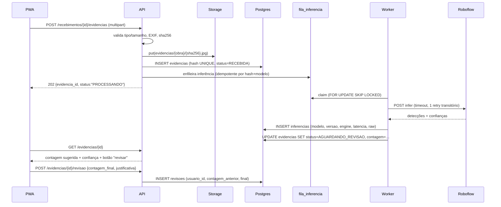

# ROBOFLOW — Arquitetura de Integração

> Proposta de desenho. **Nada aqui foi implementado.** Esboços de código são ilustrativos,
> servem para fixar contratos, não para execução.

## 1. Princípios

| # | Princípio | Consequência prática |
|---|-----------|----------------------|
| 1 | **Roboflow é detalhe de implementação** | O domínio conhece `VisionEngine`, nunca `roboflow` |
| 2 | **Evidência é nossa, não da plataforma** | Imagem original vai para o *nosso* storage; a Roboflow recebe uma cópia de trabalho (ou nada, em self-hosted) |
| 3 | **Toda inferência é auditável** | Linha em `inferencias` com modelo, versão, confiança, engine, latência e hash |
| 4 | **Reprodutibilidade** | Mesma imagem + mesmo `modelo_versao` + mesmos parâmetros ⇒ mesmo resultado (idempotência) |
| 5 | **Rascunho, não veredito** | Saída da visão é `sugestao`; só vira verdade após revisão humana registrada |
| 6 | **Degradação graciosa** | Se a visão falhar, o recebimento continua; a conferência NF-e não depende dela |
| 7 | **Sem IA generativa na contagem** | VLM/Agent só para texto auxiliar, jamais como contador |

## 2. Camadas

```
┌──────────────────────────────────────────────────────────────┐
│  API (FastAPI, sync, SQLAlchemy text())                      │
│  routers/evidencias.py      routers/visao.py                 │
└───────────────┬──────────────────────────────────────────────┘
                │  (não conhece Roboflow)
┌───────────────▼──────────────────────────────────────────────┐
│  DOMÍNIO — app/domain/visao/                                 │
│   • contagem.py     (regra de contagem, oclusão, confiança)   │
│   • protocolos.py   (VisionEngine, VisionResult)              │
└───────────────┬──────────────────────────────────────────────┘
                │
┌───────────────▼──────────────────────────────────────────────┐
│  ADAPTADORES — app/services/visao/                            │
│   • engine_roboflow.py    (cloud / self-hosted HTTP)          │
│   • engine_local.py       (inference library, in-process)    │
│   • engine_mock.py        (testes determinísticos)            │
│   • registry.py           (seleção por env + fallback)        │
└───────────────┬──────────────────────────────────────────────┘
                │
┌───────────────▼──────────────────────────────────────────────┐
│  INFRA                                                        │
│   Storage (Supabase/S3) · fila_inferencia · worker cron      │
└──────────────────────────────────────────────────────────────┘
```

A regra de negócio de contagem fica **acima** do adaptador. Trocar Roboflow por outro motor não
altera `contagem.py`.

## 3. Contratos do domínio

```python
# app/domain/visao/protocolos.py  (ilustrativo)
from dataclasses import dataclass
from typing import Protocol, Sequence, Mapping, Any

@dataclass(frozen=True)
class Deteccao:
    classe: str
    confianca: float          # 0..1, como veio do motor
    bbox: tuple[float, float, float, float]   # x1, y1, x2, y2 em pixels
    poligono: Sequence[tuple[float, float]] | None = None

@dataclass(frozen=True)
class ResultadoVisao:
    deteccoes: list[Deteccao]
    contagem_bruta: int
    engine: str                 # "roboflow-cloud" | "roboflow-selfhosted" | "local-rfdetr"
    modelo_id: str              # ex.: "steelspy-cimento/3"
    modelo_versao: str          # ex.: "3"
    latencia_ms: int
    payload_hash: str           # sha256 do raw, para auditoria
    raw: dict[str, Any] | None = None

class VisionEngine(Protocol):
    nome: str
    def inferir(
        self,
        imagem: bytes,
        *,
        modelo_id: str,
        parametros: Mapping[str, Any] | None = None,
    ) -> ResultadoVisao: ...
```

`ResultadoVisao` é o **único** tipo que atravessa a fronteira. Nenhum campo específico de Roboflow
(ex.: `predictions[].points`) vaza para o domínio.

## 4. Seleção de motor e fallback

```python
# app/services/visao/registry.py  (ilustrativo)
def cadeia_de_engines() -> list[VisionEngine]:
    """Ordem: primário configurado → fallback. Sempre termina em mock se DEV."""
    nomes = (os.getenv("VISAO_ENGINES") or "roboflow-selfhosted,roboflow-cloud").split(",")
    return [REGISTRY[n.strip()] for n in nomes if n.strip() in REGISTRY]
```

| Cenário | Cadeia |
|---------|--------|
| Piloto cloud | `roboflow-cloud` |
| Obra com servidor local | `roboflow-selfhosted` → `roboflow-cloud` (se houver rede) |
| Sem rede | `roboflow-selfhosted` → *degradado* (fica na fila) |
| Testes | `mock` (fixtures determinísticas) |

**Fallback não é retry.** Fallback = outro motor. Retry = mesmo motor, falha transitória. O código
deve distinguir os dois (o módulo `whatsapp_evolution.py` já é o modelo: `_deve_reintentar_http`
separa transitório de definitivo — reutilizar a mesma heurística e extrair para `app/utils/retry.py`).

## 5. Fluxo ponta a ponta



A **revisão humana é uma transição de estado obrigatória** quando a confiança agregada fica abaixo
do limiar — não um botão opcional.

## 6. Persistência (resumo — DDL completo em `docs/2.0/MODELO_DE_DADOS.md`)

| Tabela | Papel |
|--------|-------|
| `evidencias` | 1 linha por arquivo. `sha256` UNIQUE por obra; `storage_key`, `mime`, `bytes`, `largura`, `altura`, `capturada_em`, `origem` |
| `inferencias` | 1 linha por execução. `evidencia_id`, `engine`, `modelo_id`, `modelo_versao`, `parametros`, `confianca_agregada`, `contagem_bruta`, `latencia_ms`, `raw_hash`, `erro`, `criado_em` |
| `deteccoes` | N linhas por inferência. `classe`, `confianca`, `bbox` (jsonb), `poligono` (jsonb) |
| `revisoes_contagem` | `evidencia_id`, `usuario_id` (FK real), `contagem_anterior`, `contagem_final`, `motivo`, `criado_em` |
| `fila_inferencia` | Espelho de `fila_nfe`: `status`, `tentativas`, `proxima_tentativa`, `SKIP LOCKED` |

**Por que tabela e não JSONB único:** a consulta "quantas detecções abaixo de 0,6 nesta obra" precisa
ser SQL, não parsing em Python — é ela que vai alimentar a métrica de precisão por categoria.

## 7. Idempotência (requisito explícito)

Três níveis, cada um com sua chave:

| Nível | Chave | Efeito |
|-------|-------|--------|
| Upload | `(obra_id, sha256)` | Reenvio da mesma foto não duplica evidência nem cobra inferência |
| Inferência | `(evidencia_id, modelo_id, modelo_versao, sha256(parametros))` | Retry/duplicata devolve o resultado já calculado |
| Sincronização offline | `id_cliente` (UUID gerado no dispositivo) | Reenvio após reconexão é absorvido |

O `sha256` protege também contra o reuso de imagem de outro recebimento ("foto reciclada") — um
controle antifraude que já vale por si.

## 8. Segurança do adaptador

| Controle | Implementação |
|----------|--------------|
| API key só no backend | `os.getenv("ROBOFLOW_API_KEY")`; nunca em `pwa/js/`; nunca em query string |
| Transporte da chave | `InferenceConfiguration(api_key_transport="header")` (evita key em URL/log) |
| Timeout | `httpx.Timeout(connect=5, read=20, write=10, pool=5)` |
| Retry | 1 tentativa extra só em 408/429/5xx/timeout, backoff 1s + jitter (reutilizar padrão do WhatsApp) |
| Tamanho máximo | `MAX_BYTES` no upload (ex.: 12 MB) e redução **antes** do envio |
| SSRF | Não há URL de terceiro no caminho: a imagem é nossa (elimina o vetor A1 do diagnóstico) |
| Segredo em log | Nunca logar header `Authorization`; mascarar `model_id` de projetos privados se necessário |
| Circuit breaker | N falhas consecutivas → abre por 5 min e devolve "processando" (não erro ao fiscal) |
| Validação de resposta | Rejeitar payload sem `predictions`; validar faixa de confiança 0..1; limite de N detecções |

## 9. Versionamento de modelo

`modelo_versao` não é decorativo: é o que permite responder "por que este recebimento foi contado
assim em março e diferente em junho".

- Roboflow gera versões imutáveis por dataset (ex.: `steelspy-cimento/3`);
- a coluna guarda `workspace/projeto/versao` **e** o `sha256` do arquivo de pesos quando self-hosted;
- reprocessamento em lote (`POST /admin/reprocessar?modelo=…`) cria **nova** linha em `inferencias`,
  nunca sobrescreve;
- o laudo/dossiê cita a versão usada.

## 10. Revisão humana

```python
# app/domain/visao/contagem.py  (ilustrativo — regra, não motor)
LIMIAR_REVISAO_OBRIGATORIA = 0.75   # confiança agregada
LIMIAR_DIVERGENCIA_QTD = 0.10       # 10% vs NF

def exige_revisao(contagem: int, confianca: float, qtd_nf: float | None) -> tuple[bool, str]:
    if confianca < LIMIAR_REVISAO_OBRIGATORIA:
        return True, "confiança abaixo do limiar"
    if qtd_nf and abs(contagem - qtd_nf) / qtd_nf > LIMIAR_DIVERGENCIA_QTD:
        return True, "divergência superior à tolerância"
    return False, ""
```

A confiança agregada **não** é a média das confianças: deve penalizar detecções próximas do limiar
(ex.: usar o percentil 10 das confianças, ou o produto das probabilidades de existência). Média
esconde o caso ruim — 99 detecções a 0,99 e uma a 0,30 dá média 0,98.

## 11. Workflows: usar ou não

| Usar Workflows | Não usar |
|----------------|----------|
| Prototipagem rápida (detecção → crop → OCR) | Pipeline de produção |
| Demonstração comercial | Contratos versionados em Git |
| Time sem engenheiro de ML | Testes determinísticos e CI |

Recomendação: **prototipar em Workflows, produzir em código**. O Workflow fica como referência
documentada; o adaptador em Python é o que entra em produção, porque é testável sem rede e sem conta.

## 12. O que este desenho deliberadamente **não** faz

- Não cria endpoint de upload nesta etapa (é Fase 1 do roadmap, não deste spike).
- Não escolhe bucket definitivo (Supabase Storage atende o piloto; S3/R2 na escala).
- Não define contrato com ERP.
- Não resolve contagem por si: isso é `contagem.py` + validação experimental.

## 13. Decisão arquitetural registrada (ADR resumido)

| Campo | Valor |
|-------|-------|
| **ADR-001** | Motor de visão atrás de porta `VisionEngine` |
| **Contexto** | Precisamos de CV, mas não podemos acoplar produto a um fornecedor nem a AGPL |
| **Decisão** | Porta no domínio + adaptadores (Roboflow cloud, Roboflow self-hosted, local, mock) |
| **Consequência** | +1 camada de indireção; custo de troca de fornecedor ≈ 1 adaptador |
| **Alternativa rejeitada** | Chamar a API Roboflow direto no router (acoplamento e vazamento de licença) |
