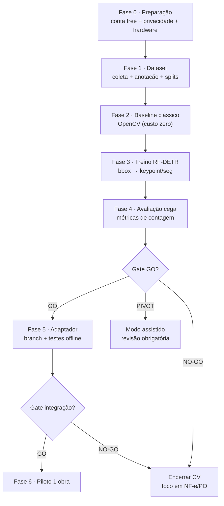

# ROBOFLOW — Plano de Integração

> Plano executável do **experimento**, não da implementação em produto.
> Nada aqui foi executado; nenhum código foi alterado.

## 1. Escopo do experimento (P0)

**Objetivo:** decidir, com números, se visão computacional entra no produto — e por qual categoria.

**Dentro:** dataset próprio mínimo, 2 modelos (vergalhão, saco), protocolo de avaliação, adaptador
esboçado em *branch* separada (só após o gate de dados).
**Fora:** produção, upload em produção, offline, ERP, multi-tenant, contratação de plano.

## 2. Fluxo de decisão

## 3. Fases, entregáveis e saída

### Fase 0 — Preparação (2 dias)

| # | Tarefa | Entregável | Bloqueia |
|---|--------|-----------|----------|
| 0.1 | Criar workspace **Free** (sem cartão) | Conta ativa | tudo |
| 0.2 | **Desligar "Data Licensing and Model Training"** e capturar print | Evidência de conformidade | qualquer upload |
| 0.3 | Confirmar projetos como **privados**; nada em Universe | Config verificada | qualquer upload |
| 0.4 | Criar projeto `steelspy-vergalhao` e `steelspy-saco-cimento` | 2 projetos vazios | Fase 1 |
| 0.5 | Definir máquina de teste self-hosted (CPU basta para Nano/Small) | Ambiente descrito | Fase 5 |
| 0.6 | Definir política de imagem: só fotos próprias ou de obras com autorização escrita | Termo de uso de imagem | Fase 1 |

**Saída:** ambiente pronto e **comprovadamente fora do regime de treino padrão**.

### Fase 1 — Dataset (2 semanas, em paralelo com campo)

| # | Tarefa | Meta |
|---|--------|------|
| 1.1 | Coleta em 3–5 obras | 800–1.200 imagens |
| 1.2 | Matriz de condições (§2.3 de `ROBOFLOW_MODEL_EVALUATION.md`) | 36 células com ≥ 20 imagens |
| 1.3 | Sanitização (rostos, placas, documentos) | 100% das imagens com rosto tratado |
| 1.4 | Anotação bbox 1 classe (vergalhão e saco) | 600 imagens por categoria |
| 1.5 | Keypoint nas 50 imagens mais difíceis (vergalhão) | 50 imagens |
| 1.6 | Split por obra — 3 obras no teste | Documentado |
| 1.7 | Versionar (Roboflow `version` + hash do manifest no Git) | 1 versão congelada |

**Saída:** dataset versionado, com teste que o modelo nunca viu.

> **Regra de ouro:** se o dataset não tiver 3 obras distintas no teste, o resultado **não vale** —
> vira auto-engano.

### Fase 2 — Baseline clássico (3 dias)

| # | Tarefa | Saída |
|---|--------|-------|
| 2.1 | OpenCV Hough Circles para seção de vergalhão (feixe frontal) | Números de contagem |
| 2.2 | Segmentação por cor/contorno para sacos em camada única | Números de contagem |
| 2.3 | Comparação com o teto esperado | "O clássico já resolve?" |

**Por que antes do modelo:** se o baseline clássico atingir o critério, o modelo aprendido passa a ser
otimização — e o risco do projeto cai muito. É a hora mais barata de descobrir isso.

**Saída:** relatório de 1 página com MAE/MAPE do baseline.

### Fase 3 — Treino (1–2 semanas, iterativo)

| # | Tarefa | Observação |
|---|--------|-----------|
| 3.1 | RF-DETR **Nano** bbox, 1 classe, vergalhão | Menor custo, mede o piso |
| 3.2 | RF-DETR **Small/Medium** bbox | Mede o ganho do tamanho |
| 3.3 | RF-DETR **Keypoint** (centro de barra) | Braço alternativo para densidade |
| 3.4 | RF-DETR **Nano/Small** saco (bbox) | Categoria 2 |
| 3.5 | RF-DETR **Seg** saco (se 3.4 ficar no limiar) | Sobreposição |
| 3.6 | Varredura de `iou_threshold` / soft-NMS | Contagem, não mAP |
| 3.7 | Registrar versões e hiperparâmetros | Rastreabilidade |

Orçamento: **≤ 8 créditos** (≈ 4 h de GPU). Cabe no Free Tier (10).

**Saída:** 4–6 modelos candidatos, cada um com sua versão.

### Fase 4 — Avaliação cega (1 semana)

| # | Tarefa |
|---|--------|
| 4.1 | Gerar predições **sem** o anotador ver |
| 4.2 | Calcular S1–S6 e R1–R6 (`ROBOFLOW_MODEL_EVALUATION.md` §6) |
| 4.3 | Matriz de confusão de contagem (erro por faixa de tamanho de pilha) |
| 4.4 | Curva confiança × acurácia (calibração) |
| 4.5 | Análise qualitativa dos 20 piores casos |
| 4.6 | Relatório final de 3 páginas + recomendação |

**Saída:** decisão GO / PIVOT / NO-GO por categoria, com números.

### Fase 5 — Adaptador (2 semanas) — **só se GO**

| # | Tarefa |
|---|--------|
| 5.1 | Branch `feat/visao-adapter` (não toca `main`) |
| 5.2 | `domain/visao/protocolos.py` + `contagem.py` + testes puros |
| 5.3 | `services/visao/engine_roboflow.py` (cloud e self-hosted) |
| 5.4 | `services/visao/engine_mock.py` + fixtures |
| 5.5 | Testes: idempotência por hash, timeout, retry, fallback, resposta inválida |
| 5.6 | Teste de contrato: mesma imagem + mesma versão = mesmo resultado |

**Saída:** adaptador testável **offline**, sem dependência de rede nos testes.

### Fase 6 — Piloto em 1 obra (4 semanas) — nota separada

Fora do escopo deste spike, mas o gate exige: 20 recebimentos reais, revisão humana de 100%,
comparação com contagem manual, NPS do fiscal.

## 4. Cronograma agregado

| Semana | Fase | Marco |
|--------|------|-------|
| 1 | F0 + início F1 | Privacidade desligada; coleta iniciada |
| 2 | F1 | 50% do dataset |
| 3 | F1 + F2 | Dataset fechado; baseline pronto |
| 4 | F3 | Primeiros modelos |
| 5 | F3 + F4 | Iteração e avaliação |
| 6 | F4 | **Gate GO/NO-GO** |
| 7–8 | F5 (se GO) | Adaptador em branch |

**Esforço total estimado:** 60–90 h de engenharia + 20–30 h de campo/anotação.

## 5. Pré-requisitos no repositório (trilha paralela, independente da Roboflow)

Estes itens são necessários para **qualquer** visão computacional e **não** dependem da Roboflow.
Sem eles, Fase 6 é impossível:

| # | Item | Onde entra | Justificativa |
|---|------|-----------|---------------|
| R1 | Endpoint de upload (`UploadFile`) + limite de tamanho + validação de tipo | `routers/evidencias.py` | Hoje **não existe**; só há `foto_url` |
| R2 | Tabela `evidencias` com `sha256` UNIQUE | migração nova | Antifraude + idempotência |
| R3 | Storage de imagem (reuso do cliente Supabase) | `services/evidence_storage.py` | Evidência é nossa |
| R4 | `fila_inferencia` (espelho de `fila_nfe`) | migração + worker | Assíncrono, não bloqueia o fiscal |
| R5 | `usuarios`/`obra_usuarios` (FK real) | migração | Revisão humana precisa de autor identificado |
| R6 | Endurecer `_carregar_imagem_url` contra redirect (SSRF) | `laudo_pdf.py` | A1 do diagnóstico |
| R7 | PWA: captura de foto + fila offline (IndexedDB) | `pwa/js/` | Requisito de campo |

> R1–R5 são **Fase 1 do roadmap 2.0**, não deste spike. Registro aqui porque são o caminho crítico
> real: o modelo é a parte fácil.

## 6. Riscos do experimento

| Risco | Prob. | Impacto | Mitigação |
|-------|-------|---------|-----------|
| Dataset pequeno demais (viés) | Alta | Alto | Mínimo 600/categoria, 3 obras no teste |
| Sobreposição derruba a contagem | Alta | Alto | Keypoint + soft-NMS + modo assistido |
| Fotos de campo piores que o esperado | Alta | Médio | Matriz de condições; guiar captura no PWA |
| Rotulagem inconsistente entre anotadores | Média | Alto | Guia de anotação + 10% revisado às cegas |
| Custo de GPU para iterar | Média | Baixo | Free Tier (5 h); preferir Nano |
| Privacidade (dados de cliente) | Média | **Crítico** | Só imagens próprias/autorizadas; setting desligado |
| Licença de dataset comunitário (BY-NC) | Média | **Crítico** | Verificar licença antes de qualquer uso |
| Overfitting na escolha de modelo | Alta | Médio | Critérios pré-registrados, decididos antes de ver números |
| Obra não colabora com padronização | Média | Médio | Modo assistido desde o início |
| Expectativa comercial de "IA que conta tudo" | Alta | Alto | Comunicar: rascunho + revisão |

## 7. Critérios de parada antecipada

Interromper o experimento (e comunicar) se:

1. Não houver autorização de imagem de nenhuma obra em 2 semanas → experimento inviável.
2. Baseline clássico já cumprir o critério → não treinar; economizar 2 semanas.
3. 3 iterações sem melhora em MAPE → o problema não é hiperparâmetro, é abordagem.
4. Custo real de anotação extrapolar 2× o estimado → reavaliar escopo.

## 8. Definition of Done do spike

- [ ] Dataset versionado e congelado, com split por obra documentado
- [ ] Baseline clássico medido
- [ ] ≥ 3 modelos treinados, com versões registradas
- [ ] Relatório de avaliação com S1–S6 e R1–R6 preenchidos
- [ ] Recomendação GO/PIVOT/NO-GO por categoria, assinada
- [ ] Confirmação documentada de que a privacidade está configurada (print do setting)
- [ ] Nenhum código em `main` alterado
- [ ] Custo incorrido: **US$ 0**

## 9. Rollback

Como nada é implementado em produto, **não há rollback a executar**. Se a Fase 5 avançar:

- todo trabalho fica em branch isolada, atrás de `VISAO_HABILITADA=0` (feature flag desligada);
- a flag desligada mantém o comportamento atual byte a byte;
- nenhuma migração é aplicada em produção antes do gate de integração.
